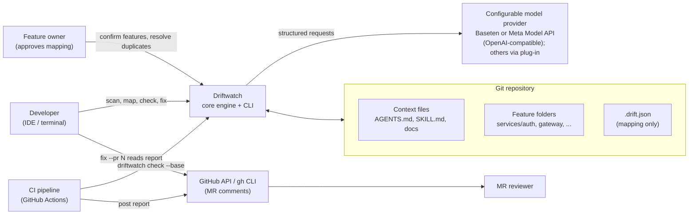
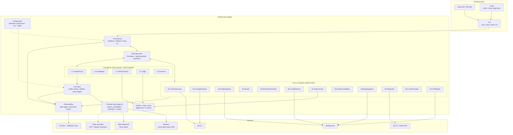
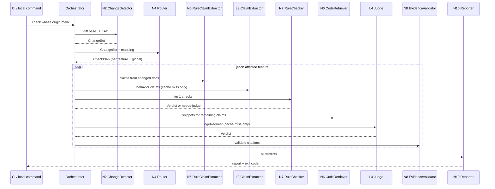
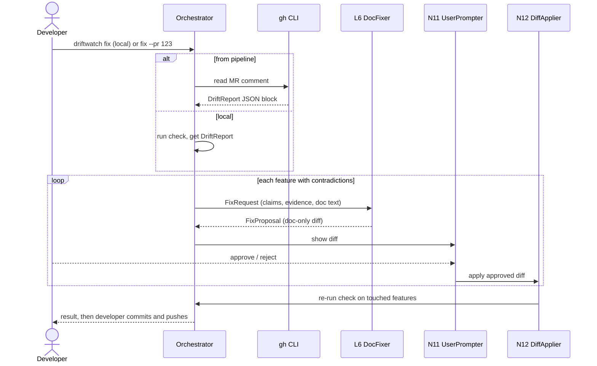

# Driftwatch: Architecture Design

Status: Draft v1 (hackathon build)
Audience: engineers building and reviewing Driftwatch

---

## 1. Purpose and scope

Context files (`AGENTS.md`, `SKILL.md`, feature docs) are **claims about the code**. When code changes and the doc does not, coding agents and humans get wrong context. Driftwatch finds those mismatches, proposes fixes, and keeps checking on every merge request (MR).

**Scope rule:** a capability is in scope only if it helps detect or fix a mismatch between a specific claim in a context file and a specific piece of code. If it cannot point to both, it is out of scope.

In scope:

- Discover context `.md` files and the feature folders they should describe
- Map each feature folder to the context file(s) that genuinely explain it
- Create or edit context files so they match code (human approves every diff)
- Check claims against code locally and on every MR
- Report pass/fail with the exact claim and the exact contradicting code

Out of scope: general model/prompt evaluation, dashboards, auto-merging doc edits, rewriting docs to match buggy code, supporting every IDE and file format in v1.

---

## 2. Design principles

1. **One engine, two surfaces.** The agent (IDE/CLI) and the pipeline (CI) call the same core, so they always agree on what counts as drift.
2. **Deterministic first, LLM last.** Cheap exact checks run first. The LLM judge only sees claims rules cannot resolve.
3. **Evidence or it did not happen.** Every `supported` or `contradicted` verdict cites `file:line`. Verdicts without valid citations are discarded.
4. **Git is the source of truth for change.** Hashes are computed at run time from git. Nothing that changes on every MR is committed.
5. **Humans approve changes.** The agent proposes diffs; a developer accepts. The pipeline never edits files.
6. **Code may be the wrong side.** When the doc could be right and the code buggy, flag for a human decision instead of rewriting the doc.
7. **Structured messages between components.** Agents exchange validated JSON objects, never free text.
8. **Pluggable models.** The LLM provider, base URL, and model name are configuration. No agent knows which vendor it is talking to.
9. **Observable by default.** Every step logs what it ran, with which key parameters and what it returned, so a run can be debugged from its logs.

---

## 3. System context



---

## 4. Component diagram



---

## 5. Components

### 5.1 Non-LLM agents

| ID | Name | Responsibility | Input -> Output |
|---|---|---|---|
| N1 | ContextScanner | List `.md` files with `git ls-files '*.md'`, drop deny-listed ones (CHANGELOG, LICENSE, vendored dirs), tag known context names (`AGENTS.md`, `SKILL.md`) | repo path -> `ContextInventory` |
| N2 | ChangeDetector | Ask git what changed between base and head, plus per-file hashes (`git hash-object`) and folder hashes (`git rev-parse HEAD:<folder>`) | base, head -> `ChangeSet` |
| N3 | FolderDigester | Build a size-capped digest of a feature folder: tree, public symbols, commands from `Makefile`/`package.json`, key file heads | folder -> `FolderDigest` |
| N4 | Router | Map changed files to features (longest folder prefix), add `global`, pick the change-matrix case per feature | `ChangeSet` + mapping -> `CheckPlan` |
| N5 | RuleClaimExtractor | Regex/AST extraction of checkable claims: paths, commands, flags, symbols | doc text -> `ClaimSet` |
| N6 | CodeRetriever | Select the code snippets a claim refers to (symbol grep, changed files first), within a token budget | claim + folder -> `CodeContext` |
| N7 | RuleChecker | Tier 1 checks: path exists, symbol exists, command/target exists. Optional tier 2: run documented command in a sandbox | claim -> `Verdict` or "needs judge" |
| N8 | EvidenceValidator | Verify every cited `file:line` exists and was in the provided context; discard verdicts that fail | `Verdict` -> `Verdict` or rejection |
| N9 | MappingStore | Read, validate, and write `.drift.json` | mapping ops -> file |
| N10 | Reporter | Render `DriftReport` as Markdown + embedded JSON block, set exit code, post MR comment | `Verdict[]` -> report |
| N11 | UserPrompter | Interactive questions: confirm features, resolve duplicate docs, approve diffs | question -> answer |
| N12 | DiffApplier | Apply an approved unified diff to docs only, re-run check | `FixProposal` + approval -> files |

### 5.2 LLM agents

Each LLM agent has a prompt of **500 characters or fewer**. All data goes in a separate structured JSON request, and the answer must match a JSON schema.

| ID | Name | Job | Input -> Output |
|---|---|---|---|
| L1 | FeatureScout | Propose feature folders (not every folder) from the tree, manifests, `CODEOWNERS` | `FeatureScoutRequest` -> `FeatureProposal` |
| L2 | DocMapper | Decide if a doc genuinely explains a feature, with quoted proof | `DocMapRequest` -> `DocMatch` |
| L3 | ClaimExtractor | Extract behavior and convention claims rules cannot find | `ClaimExtractRequest` -> `ClaimSet` |
| L4 | Judge | Judge one claim against code | `JudgeRequest` -> `Verdict` |
| L5 | SkillAuthor (retired, MAP no longer drafts skills) | Was: draft a new `SKILL.md` for a feature with no doc | `AuthorRequest` -> `DocDraft` |
| L6 | DocFixer | Propose a doc-only diff for contradicted claims | `FixRequest` -> `FixProposal` |

### 5.3 Supporting pieces

- **Orchestrator:** plain Python workflows (`onboard`, `check`, `fix`). It routes messages and enforces order. It contains no model logic.
- **LLM client:** vendor-neutral. Resolves the profile for an agent, calls a provider, validates the reply against the expected payload type, retries once with the validation errors, and tracks a per-run call budget.
- **Provider layer:** a small `LLMProvider` interface with normalized request and response types. `openai_compatible` (using the `openai` library) covers Baseten, the Meta Model API, GPT models, and similar endpoints. Other SDKs, such as Claude's, plug in as one new file or a dotted-path class, with no agent changes.
- **Config loader:** reads `driftwatch.config.yaml`, applies environment variable and CLI flag overrides, and validates the result. Secrets are never in the file; profiles name the environment variable that holds the key.
- **Observability:** a step logger shared by the Orchestrator, agents, and LLM client. Each payload type provides a `log_summary()` of its important fields, so logs show parameters and results without dumping whole payloads.
- **Cache:** claim extraction keyed by doc-file hash; verdicts keyed by hash(claim text + referenced code snippets). Stored under `.drift/cache/` (gitignored) and restored in CI with the CI cache.

---

## 6. Data model

### 6.1 `.drift.json` (committed, mapping only)

This file changes only when someone onboards or re-maps a feature, not on every MR, so it does not cause merge conflicts.

```json
{
  "version": 1,
  "verified_at": "a1b2c3d",
  "global": {
    "context_files": ["AGENTS.md"]
  },
  "features": {
    "auth": {
      "folder": "services/auth",
      "owners": ["@team-identity"],
      "context_files": ["services/auth/SKILL.md"],
      "status": "enforced"
    },
    "gateway": {
      "folder": "services/gateway",
      "owners": ["@team-edge"],
      "context_files": ["skills/gateway/SKILL.md"],
      "status": "onboarded"
    }
  },
  "ignored_docs": ["CONTRIBUTING.md"],
  "resolutions": {
    "duplicate:auth": "services/auth/SKILL.md"
  }
}
```

- `status`: `unonboarded` (ignored), `onboarded` (warn-only), `enforced` (failures block the MR).
- `resolutions` stores answers to duplicate-doc questions so the user is never asked twice.
- No hashes are stored here.

### 6.2 Derived at run time (never committed)

| Value | How it is obtained |
|---|---|
| Changed files in an MR | `git diff --name-only <base>...HEAD` |
| Folder content hash | `git rev-parse HEAD:<folder>` |
| Context file hash | `git hash-object <file>` |
| Claims for a doc | Extracted, cached by doc-file hash |

### 6.3 Core message types

| Type | Key fields |
|---|---|
| `ContextInventory` | `files[]`: path, hash, kind (`known` or `candidate`) |
| `FeatureProposal` | `features[]`: name, folder, reason |
| `DocMatch` | feature, doc path, `match`, `quote`, `confidence` |
| `Claim` | id, doc path, line, text, kind (`path\|symbol\|command\|behavior\|convention`), tier |
| `Verdict` | claim id, `supported\|contradicted\|unverifiable`, evidence (`file:line[]`), `needs_human`, tier |
| `CheckPlan` | per feature: case (`none\|code_only\|doc_only\|both`), changed code files, changed docs |
| `DriftReport` | summary counts, verdicts, per-feature status, mode |
| `FixProposal` | feature, doc path, unified diff, skipped claims |

Full envelope and examples are in the implementation plan.

---

## 7. Key flows

### 7.1 Onboarding (first time in a repo)

```mermaid
sequenceDiagram
    actor U as User / Owner
    participant O as Orchestrator
    participant N1 as N1 ContextScanner
    participant L1 as L1 FeatureScout
    participant N3 as N3 FolderDigester
    participant L2 as L2 DocMapper
    participant N11 as N11 UserPrompter
    participant N9 as N9 MappingStore

    U->>O: driftwatch scan / map
    O->>N1: scan repo
    N1-->>O: ContextInventory
    O->>L1: FeatureScoutRequest (tree, manifests, owners)
    L1-->>O: FeatureProposal
    O->>N11: confirm features
    N11-->>U: list of proposed features
    U-->>N11: confirm / edit
    loop each confirmed feature
        O->>N3: digest folder
        N3-->>O: FolderDigest
        O->>L2: DocMapRequest (feature, doc excerpts)
        L2-->>O: DocMatch[] (with quotes)
        O->>N9: save feature mapping (all matching docs, no primary)
        note over O: 2+ docs matching is normal (covering docs);<br/>no canonical pick, CHECK verifies every doc
    end
    N9-->>U: .drift.json written
```

After mapping, the initial drift check (section 7.2 logic, run on the whole feature) verifies each doc and offers fixes through the fix flow.

### 7.2 MR check (pipeline and local)



**Change matrix** (decides what is checked per feature):

| Code changed | Doc changed | Action |
|---|---|---|
| No | No | Skip, pass |
| Yes | No | Main drift case: check claims that reference the changed code |
| No | Yes | Check that the new doc text is true against current code |
| Yes | Yes | Check both; editing the doc does not prove it is right |

Extra rules:

- `global` context files (root `AGENTS.md`) get **deterministic checks only**, on every MR.
- A changed folder that maps to no feature produces a warning ("unmapped folder"), not a failure.
- Changed files outside any mapped feature and any claim reference are ignored, so unrelated MRs stay green.

### 7.3 Fix loop



Claims marked `needs_human` are never auto-fixed. They are listed for a decision.

---

## 8. Checking model

Each claim becomes one eval, resolved in the cheapest tier that works:

| Tier | Method | Example claim |
|---|---|---|
| 1. Deterministic | Path, symbol, flag, or command exists | "`make test-auth` runs the suite" |
| 2. Behavioral | Run documented command in a sandbox, compare output | "`./cli --help` lists `--dry-run`" |
| 3. LLM judge | Rules cannot resolve it | "Sessions use a sliding expiry" |

Verdicts: `supported`, `contradicted` (counts as drift), `unverifiable` (claim needs tightening).

Rules:

- A `supported` or `contradicted` verdict **must** cite `file:line`. EvidenceValidator confirms the line exists and was part of the context shown to the judge.
- Tier 3 findings are **advisory** until measured accuracy is acceptable.
- Cache key is hash(claim + referenced code), so unchanged claims are never re-judged.

---

## 9. Agent communication

All agents exchange a typed **Envelope** with a typed payload, validated on send and receive. Plain-text hand-offs between agents are not allowed.

- Non-LLM agents are Python functions: `handle(Envelope[In]) -> Envelope[Out]`.
- LLM agents receive a short instruction prompt (500 characters or fewer) plus the payload as a JSON request, and must reply in a JSON schema that maps to the next payload type.
- The same envelopes are written to `.drift/runs/<correlation_id>/*.json`, so a CI run can be replayed and the fix flow can read it.
- Every payload type implements `log_summary()`; log lines reference the envelope file for the full payload.

Details, schemas, and examples: see `driftwatch_implementation_plan.md`.

---

## 10. Pipeline integration

- One command everywhere: `driftwatch check --base origin/main`.
- CI job steps: checkout with full history, restore cache, run `check`, post the Markdown report as an MR comment, set exit code from mode.
- The MR comment contains a human-readable table and a hidden block `<!-- driftwatch:report {json} -->` so `fix --pr N` can read it without extra plumbing.
- Mode per feature: `onboarded` is warn-only (exit 0), `enforced` fails the job when a `contradicted` verdict exists.
- Heavy generation (L5, L6) never runs in the pipeline. The pipeline only runs checks.
- CI uses `--log-format plain` and uploads `.drift/logs/` as an artifact on every run, so a failed or surprising result can be traced step by step.

---

## 11. Models and infrastructure

- Default profile: `baseten` with `meta-models/muse-spark-open-1026` (the hackathon-specific name, not the one in public docs). A second profile, `meta_api`, calls the Meta Model API directly with the `openai` library. Hackathon rule: Meta models only, so these two ship active.
- Provider, base URL, and model name are set per profile in `driftwatch.config.yaml`, and any agent can be pointed at a different profile (for example Judge and DocMapper on a stronger model while FeatureScout and ClaimExtractor stay on the cheaper one). GPT, Claude, or other vendors are future profiles or providers, not v1 work.
- LLM calls use structured output (preferred `json_schema`, falling back to `json_object`, then prompt-only with the schema sent as request data), temperature 0, and one retry on schema failure.
- Per-run call budget; on exhaustion remaining claims become `unverifiable` rather than failing the build.

---

## 12. Configuration

Tool settings live in `driftwatch.config.yaml`, separate from `.drift.json` (the feature mapping). The file is committed and contains no secrets.

| Section | Controls |
|---|---|
| `llm.profiles` | Named provider configurations: provider, base URL, key variable name, model, structured-output mode, timeout |
| `llm.default_profile`, `llm.agents` | Which profile each LLM agent uses |
| `llm.call`, `llm.budget` | Temperature, retries, backoff, per-run call and token limits |
| `logging` | Level, console format, log file location, truncation and redaction rules |
| `scan`, `check`, `cache` | Deny globs, known context file names, default warn or enforce mode, cache location |

Precedence: CLI flags, then environment variables, then the config file, then built-in defaults. `driftwatch config show` prints the resolved result with secrets redacted, and `driftwatch llm ping` tests a profile. The full example file is in `driftwatch_implementation_plan.md`, section 7.

---

## 13. Logging and observability

Every run produces a readable step trace and a structured log, so you can see which step ran, with which key parameters, and what it returned.

- **Sinks:** console (pretty, plain, or JSON), a JSONL file at `.drift/logs/<run_id>.jsonl`, and the full message envelopes under `.drift/runs/<run_id>/`. Log lines point to the envelope file for the full payload.
- **Levels:** `INFO` shows one line per step with important parameters and a result summary, plus LLM call summaries (profile, model, tokens, latency). `DEBUG` adds the reasons behind decisions (why a claim went to the judge, cache hit or miss, provider fallbacks). `TRACE` adds truncated request and reply excerpts to the file only.
- **Important parts only:** each payload type defines `log_summary()`. Long strings are truncated, long lists show a count and the first items, and keys matching the redact list are masked. API key values are never logged.
- **Viewing:** `driftwatch logs --run latest --agent N7 --level DEBUG` filters and pretty-prints a run. In CI the log directory is uploaded as an artifact.

Example (INFO):

```
10:15:30 INFO  [2/7] N4.Router  ok auth=both payments=code_only | unmapped=[] | skipped=gateway(no change) 12ms
10:15:33 INFO  [6/7] LLM  profile=meta_api model=muse-spark-1.1 mode=json_schema attempt=1 in=1.8k out=96 tokens 1.9s
10:15:35 INFO  [6/7] L4.Judge  ok contradicted evidence=[services/auth/session.py:42] needs_human=false
```

The full list of what each step logs, the event format, and the debugging recipe are in `driftwatch_implementation_plan.md`, section 8.

---

## 14. Risks and mitigations

| Risk | Mitigation |
|---|---|
| LLM judge false alarms erode trust | Deterministic-first, advisory tier 3, evidence validation, warn-only default, metric tracking |
| Hallucinated citations | EvidenceValidator rejects any `file:line` not in the provided context |
| Large repos: many features | Owner-driven onboarding per feature, status flags, only changed features checked on MRs |
| Slow or costly pipeline | Hash-keyed cache, per-run budget, tier ordering |
| Docs that mention a feature but do not describe it | DocMapper must return a verbatim quote; no quote means no match |
| Doc is right, code is buggy | `needs_human` flag; fixer skips those claims |
| Monorepo path confusion | Claim paths resolve from repo root; nested doc scope limited to its own subtree |
| Merge conflicts on the mapping file | Mapping only, no per-MR values stored |
| A provider does not support schema-constrained output | Structured-output ladder with automatic downgrade; reply always validated against the pydantic type |
| Secrets or large payloads leak into logs | Config names env vars only; redact keys, truncation limits, full payloads only in local envelope files |
| Provider or model names change | They live in config; `driftwatch llm ping` checks a profile before a run |

---

## 15. Success metrics

- Inject about 20 realistic drifts (renamed function, removed flag, changed command, new undocumented module) into a real repo.
- Report: number caught, number missed, false alarms.
- Include at least one MR that changes code with no related claims and stays green.
- Fix loop demo: red check, `driftwatch fix`, green check.

---

## 16. Glossary

- **Context file:** a `.md` file meant to inform coding agents (`AGENTS.md`, `SKILL.md`, feature docs).
- **Feature folder:** a top-level functional folder (auth, gateway, licensing), not a nested helper directory.
- **Drift:** a claim in a context file that the code no longer supports.
- **Claim:** one atomic, checkable statement from a context file.
